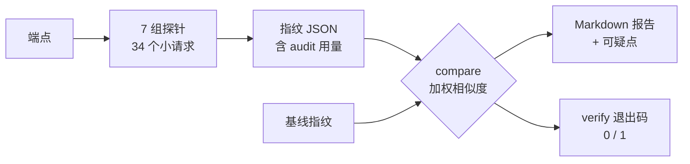

# model-fp · 模型指纹探测与对比

[](https://github.com/Woshichinese114514/model-fp/actions/workflows/test.yml)
[](LICENSE)
[](https://www.python.org/)
[](#快速开始)

> 用 **34 个极小请求 / ~840 token / 30 秒**，判断一个 API 背后到底是不是"原来那个模型"。

`model-fp` 对任意 OpenAI / DeepSeek / Anthropic 兼容端点做一次小输入探测，产出可存档的
**指纹 JSON**；再把任意两份指纹对比出结论：是不是同一模型、同一权重、同一后端。

它不评价模型"好不好用"，只回答**身份**问题。

---

## 目录

- [它解决什么问题](#它解决什么问题)
- [亮点](#亮点)
- [快速开始](#快速开始)
- [命令参考](#命令参考)
- [7 组指纹](#7-组指纹)
- [成本](#成本)
- [怎么读结论](#怎么读结论)
- [实测数据](#实测数据)
- [工作原理](#工作原理)
- [已知坑](#已知坑)
- [FAQ](#faq)
- [安全](#安全)
- [目录结构](#目录结构)
- [开发与贡献](#开发与贡献)
- [License](#license)

## 它解决什么问题

- 中转站号称 `deepseek`（或是GPT Claude），实际是不是同一个模型？
- 两个 key、两个地址，是否打到同一个后端 / 同一份权重？
- 同名模型有没有被悄悄换成旧版本、量化版或别的家族？
- 想做回归监控：每天跑一次，指纹漂了就报警。

传统判断靠 `/models` 列表或模型自称，这两者都能被网关改写；`model-fp` 采的是
**协议字段 + token 计数 + 概率分布** 层面的证据，并且每一项都能独立复核。

## 亮点

- **小输入**：单请求 prompt ≤ 64 token、输出 ≤ 16 token（写死在探针定义里），一轮 34 个请求
- **多证据**：7 组独立指纹；某组不可比时自动剔除并重新归一化权重，不会因一个能力缺失就误判
- **可审计**：指纹内附带逐请求 `audit`（路径 / 状态码 / 耗时 / token 用量），成本一目了然
- **可回归**：`verify` 用退出码表达通过与否，直接接 cron / CI
- **零依赖**：纯 Python 标准库，3.9+ 即可
- **可扩展**：加一组探针只需四步（见 [references/probe-design.md](references/probe-design.md)）

## 快速开始

### 1. 安装

```bash
git clone https://github.com/Woshichinese114514/model-fp.git
cd model-fp
python3 --version   # 需要 3.9+
```

### 2. 提供 key

```bash
export DEEPSEEK_API_KEY=sk-xxx
# 也可以：--api-key sk-xxx，或写入 ~/.config/model-fp/key（一行）
```

### 3. 采集基线

```bash
python3 scripts/model_fp.py probe \
  --base-url https://api.deepseek.com \
  --model deepseek-flash --label official
```

```text
目标      : deepseek-official @ https://api.deepseek.com  (model=deepseek-flash, prefix='')
指纹哈希  : sha256:74aff70566b4...
system_fp : bc19ba97cbe016479903222bb1578db6
端点模型  : deepseek-flash, deepseek-v4-pro
tokenizer : raw（14 个字符串）
logprobs  : True
流式      : 200
探测开销  : 34 请求 / 836 prompt tokens / 86 completion tokens / 28.7s
已保存: baselines/official-deepseek-flash.json
```

### 4. 探测待测端点并对比

```bash
python3 scripts/model_fp.py probe \
  --base-url https://relay.example.com/v1 \
  --model deepseek-chat --label relay

python3 scripts/model_fp.py compare \
  baselines/official-deepseek-flash.json \
  baselines/relay-deepseek-chat.json
```

报告摘录：

```text
[OK] 指纹一致 —— 综合相似度 98.8%（置信度 high，强证据占比 65%）
> 几乎可以确定是同一个模型（同一权重/同一后端）
```

### 5. 接监控

```bash
python3 scripts/model_fp.py verify \
  --baseline baselines/official-deepseek-flash.json \
  --base-url https://relay.example.com/v1 --model deepseek-chat \
  --threshold 0.90
echo $?   # 0 = 通过；1 = 漂移
```

## 命令参考

### 子命令

| 命令 | 作用 | 典型用法 |
|---|---|---|
| `probe` | 探测端点，写指纹 JSON | `probe --base-url ... --model ...` |
| `compare` | 两份指纹对比，输出 Markdown 报告 | `compare a.json b.json --fail-below 0.9` |
| `matrix` | 多份指纹两两矩阵 | `matrix baselines/*.json` |
| `verify` | 现场探测 + 比基线，按阈值返回退出码 | `verify --baseline a.json --base-url ...` |
| `models` | 列出端点模型清单 | `models --base-url ...` |

### 公共参数

| 参数 | 说明 | 默认 |
|---|---|---|
| `--base-url` | 端点根地址 | — |
| `--api-prefix` | 强制 API 前缀 | 自动探测 `""` 或 `/v1` |
| `--api-key` | API key | 环境变量 / key 文件 |
| `--target` | `config.json` 里的目标名 | — |
| `--config` | `config.json` 路径 | — |
| `--timeout` | 单请求超时（秒） | 60 |
| `--retries` | 失败重试次数 | 2 |

### probe / verify 专有参数

| 参数 | 说明 | 默认 |
|---|---|---|
| `--model` | 模型名（verify 时默认取基线里的） | — |
| `--label` | 指纹展示名 | 模型名 |
| `--groups` | 只跑部分组，逗号分隔 | 全部 |
| `--max-requests` | 请求数硬上限（成本护栏） | 80 |
| `--all-models` | 探测端点列出的全部模型 | false |
| `--out` | 输出路径 | `baselines/<label>-<model>.json` |
| `--threshold` | verify 通过阈值 | 0.90 |

```bash
# 只跑身份 + 词表：19 个请求（含 identity 的 2 次取样）
python3 scripts/model_fp.py probe --base-url https://relay/v1 --model deepseek-chat \
  --groups metadata,identity,tokenizer
```

## 7 组指纹

| 组 | 探针内容 | 请求 | 主要分辨什么 |
|---|---|---|---|
| identity | `system_fingerprint`、响应 id 格式、`model` 回显、**隐藏提示词开销** | 0（派生） | 是否同一个后端 / 同一份服务端配置 |
| tokenizer | 14 个短串在 `/beta/completions` 下的 `prompt_tokens` 向量 | 14 | 词表差异（换模型/换家族） |
| first_step | 固定前缀、温度 0 的 `top_logprobs`（推理首 token） | 4 | 权重差异（同词表也能分辨） |
| continuation | 温度 0 续写文本 + 推理前缀（只比稳定前缀） | 6 | 版本 / 量化差异 |
| protocol | SSE 分块字段、`json_object`、`tools`、FIM、Anthropic 兼容面、usage 字段 | 5 | 网关 / 推理框架改写 |
| metadata | `/models` 全字段、`/user/balance`、错误模板 | 3 | 官方端点 vs 中转 |
| determinism | 同请求两次是否逐字一致 | 2 | 采样层 / 缓存层 |

### 请求账本（合计 34）

| 探针 | 请求 | 说明 |
|---|---|---|
| metadata.models | 1 | 前缀探测的 `GET /models` 被复用，不重复发 |
| metadata.balance | 1 | `/user/balance` |
| metadata.error_shape | 1 | 用不存在的模型名触发 400，取错误模板 |
| protocol.stream | 1 | SSE 分块 |
| protocol.json_object | 1 | `response_format` |
| protocol.tools | 1 | 单个函数工具 |
| protocol.fim | 1 | `/beta/completions` + `suffix` |
| protocol.anthropic | 1 | `/anthropic/v1/messages`（不支持时 +1~3 次路径兜底） |
| tokenizer | 14 | 14 个短串各 1 次；端点无 `/beta` 时改用 chat，仍 14 次 |
| first_step | 4 | 4 个固定前缀 |
| continuation | 6 | 4 次裸续写 + 2 次推理前缀 |
| identity | 0 | **派生组**：从上面这些响应里提取，不单独发请求 |
| determinism | 2 | 同一请求发两次 |
| **合计** | **34** | 与指纹里的 `cost.requests` 和 `audit` 长度一致 |

> `identity` 单独跑（`--groups identity`）时会临时发 2 个 chat 请求取样；与其他组一起跑则完全复用已有响应。


其中 **隐藏提示词开销** 是实测最好用的一项：同一段文本，chat 请求的 `prompt_tokens`
减去裸 completion 的计数，得到的差值 = chat 模板 + 服务端注入的隐藏 system prompt。
实测 DeepSeek flash 为 29、v4-pro 为 82（连测三次稳定），网关很难伪造。

## 成本

| 模式 | 请求数 | prompt tokens | 输出 tokens | 耗时 |
|---|---|---|---|---|
| 完整探测（7 组） | 34 | ~840 | ~86 | 25~35s |
| 精简 `--groups metadata,tokenizer` | 17 | ~64 | ~14 | 10~13s |
| 精简 `--groups metadata,identity,tokenizer` | 19 | ~144 | ~45 | 12~15s |
| `verify` 回归一次 | 34 | ~840 | ~86 | 25~35s |

按 DeepSeek 现价，一轮完整探测的成本在**分币级**；指纹里的 `audit` 可以直接对账。

## 怎么读结论

| 相似度 | 结论 | 建议处置 |
|---|---|---|
| ≥ 95% | 指纹一致 | 同一模型、同一权重、同一后端 |
| 85% ~ 95% | 高度相似 | 同族但可测差异：看分组得分定位（版本 / 量化 / 网关改写） |
| 65% ~ 85% | 相关但不一致 | 部分吻合，人工复核分组明细与「可疑点」 |
| < 65% | 指纹不同 | 不像同一个模型 |

- **置信度**（high/medium/low）由强证据组（identity / tokenizer / first_step）是否可比决定；
  关键组缺失时会自动把 same/family 降级为 related。
- 报告里「可疑点 / 提示」会逐条列出：`system_fingerprint` 不一致、`model` 回显被改写、
  缺 `/user/balance`、缺 logprobs、隐藏提示词开销不同等。

## 实测数据

DeepSeek 官方端点，2026-11：

| 对比 | 综合相似度 | 结论 |
|---|---|---|
| `deepseek-flash` 连测两次 | **98.8%** | 指纹一致 |
| `deepseek-flash` vs `deepseek-v4-pro` | **75.7%** | 相关但不一致 |
| 隔一段时间再 verify `deepseek-flash` | **95.3%** | 指纹一致（续写文本的天然抖动） |

同模型不会满分：**95%~99% 属于正常**，所以阈值建议 0.90~0.95，不要设到 0.99。

样例见 [`examples/`](examples/)：

- [`examples/matrix.md`](examples/matrix.md)
- [`examples/baselines/deepseek-flash.json`](examples/baselines/deepseek-flash.json)

## 工作原理



1. **探针**是固定的极小样本（短前缀、1~16 个输出 token），保证可重复、低花费。
2. **指纹**是这些观测的可序列化快照，带稳定哈希；同一份指纹可长期存档做基线。
3. **比对**是分组加权相似度：强证据组权重大，不可比组自动剔除并重归一化。

打分公式与指纹 schema 见 [references/probe-design.md](references/probe-design.md)。

## 已知坑

1. **内容风控会误伤纯文本探针**：`/beta/completions` 送某些中文短语会返回
   `400 Content Exists Risk`。已改为逐串跳过，不让整组失效。
2. **reasoning 并不完全确定**：即使 `temperature=0 + seed`，推理 token 约 10 个后仍会分叉。
   所以推理文本只比稳定前缀、只给 0.2 权重。
3. **网关会剥离能力**：缺 logprobs、缺 `/beta/completions`、改写 `system_fingerprint`
   都很常见；对应组会标"不可比"并降权，结论置信度随之下降。
4. 同一模型重复探测不会 100%：续写文本本身有非确定性。

细节与实测数据见 [references/known-quirks.md](references/known-quirks.md)。

## FAQ

**支持哪些端点？**
任何 OpenAI 兼容端点（`/chat/completions`、`/models`），DeepSeek 额外支持
`/beta/completions` 与 `/user/balance`，Anthropic 兼容面也会顺带探测。API 前缀 `""` 与 `/v1` 自动识别。

**为什么同一模型不是 100%？**
续写/推理文本在温度 0 下仍有少量非确定性（GPU 批量调度导致）。分数落在 95%~99% 属正常。

**端点不支持 logprobs 怎么办？**
first_step 组标记"不可比"，权重自动分给其他组，结论置信度会降为 medium；不会报错退出。

**会不会被风控/封号？**
一轮只有 34 个请求、每个 1~16 个输出 token，远低于正常使用量。但探针文本是公开的固定串，
若端点方严格审查，仍可能被识别为探测流量——用自己的 key、控制频率即可。

**key 安全吗？**
key 只从参数/环境变量/key 文件读取，不写入指纹，仓库也 gitignore 了 `.env`。

**它和 benchmark 有什么区别？**
benchmark 测"能力"，本工具测"身份"。两者互补：身份一致是能力对比有意义的前提。

**能分辨"蒸馏 / 微调 / 量化"吗？**
词表相同但概率分布与续写不同 → 通常会落在 65%~95% 区间（related/family），
配合分组明细可以判断差异出在概率层还是词表层。

## 安全

- 探针内容全部是固定短串，不涉及业务数据；指纹只存协议字段与 token 计数。
- key 支持 `--api-key`、环境变量（`MODEL_FP_API_KEY` / `DEEPSEEK_API_KEY` /
  `OPENAI_API_KEY` / `ANTHROPIC_API_KEY`）与 `~/.config/model-fp/key`。
- 仓库内不包含任何 key；`.env` 已在 `.gitignore`。

## 目录结构

```text
model-fp/
├── SKILL.md                 # 作为 DSH skill 使用时的定义（触发词 / 用法 / 坑）
├── scripts/
│   ├── model_fp.py          # CLI 入口
│   ├── config.example.json  # --target 用的端点配置样例
│   ├── fpkit/
│   │   ├── client.py        # 传输层：重试 / SSE / 用量记账
│   │   ├── probes.py        # 7 组探针定义与执行
│   │   ├── fingerprint.py   # 指纹 schema + 稳定哈希
│   │   ├── compare.py       # 分组打分 / 置信度 / 结论
│   │   ├── report.py        # Markdown 渲染
│   │   └── cli.py           # 子命令
│   └── tests/test_compare.py# 11 个离线单测（不联网）
├── references/
│   ├── probe-design.md      # schema、打分公式、如何加探针
│   └── known-quirks.md      # 已踩过的坑与实测数据
├── examples/                # 实测指纹与报告样例
├── .github/workflows/test.yml
├── CHANGELOG.md
├── CONTRIBUTING.md
└── LICENSE                  # GPL-3.0
```

## 作为 DSH skill 使用

仓库根目录就是 skill 本体（`SKILL.md` + `scripts/` + `references/`）：

```bash
git clone https://github.com/Woshichinese114514/model-fp.git ~/.dsh/skills/model-fingerprint
```

之后在新会话里直接说「帮我看看这个中转是不是真 DeepSeek」，技能会自动加载。

## 开发与贡献

```bash
cd scripts
python3 -m unittest discover -s tests -v
```

加一组探针的四个步骤、提交规范、PR 清单见 [CONTRIBUTING.md](CONTRIBUTING.md)。

## License

[GNU General Public License v3.0](LICENSE)（`GPL-3.0-or-later`）。

这是一个 copyleft 许可：你可以自由使用、修改、分发，但**分发修改后的版本时必须以 GPL-3.0 开源**。
内部使用、私有部署没有任何限制。若不希望受 copyleft 约束，请联系作者讨论其他授权方式。

## 人类的话
deepseek太好用啦！
